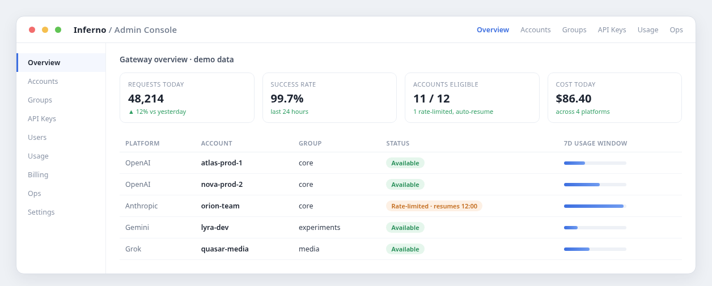

<h1 align="center">Inferno</h1>

<p align="center">
  One endpoint for all your AI accounts.<br/>
  An open-source API gateway that pools upstream provider accounts and routes every request to one that can serve it.
</p>

<p align="center">
  <a href="backend/go.mod"></a>
  <a href="inferno-frontend/package.json"></a>
  <a href="LICENSE"></a>
</p>

<p align="center">
  <code>Your apps &rarr; Inferno &rarr; pooled OpenAI &middot; Anthropic &middot; Gemini &middot; Grok accounts</code>
</p>

<p align="center">
  
</p>

<p align="center"><sub>Illustrative admin-console mockup with fictional demo data; not a screenshot of the live UI.</sub></p>

---

Inferno sits between your applications and AI subscription platforms. Your clients talk to a single Inferno deployment; Inferno spreads the traffic across a pool of upstream provider accounts, tracks the health and rate-limit state of every account, and gives you an admin console to manage accounts, groups, API keys, users, usage, and billing.

## Highlights

- **Multi-platform accounts** - add OpenAI, Anthropic, Gemini, and Grok accounts and organize them into groups that share traffic.
- **Smart scheduling** - accounts that hit provider rate limits are temporarily excluded from routing and become eligible again when the provider's reset time passes.
- **Composite groups** - let one API key route across providers based on the requested model, with an admin-configured registry for public model aliases.
- **Usage and cost tracking** - per-account and per-user usage, cost, and request monitoring in the admin UI.
- **Optional built-in payments** - self-service user top-ups without deploying a separate payment service.
- **Single deployment** - one Go binary with the Vue admin console embedded, plus Postgres and Redis.

## Quick start with Docker

Requires Docker. Clone the repository and build from source:

```bash
git clone https://github.com/Open-Computer-AI/inferno.git
cd inferno
[ -s deploy/.env ] || printf 'POSTGRES_PASSWORD=%s\n' "$(openssl rand -base64 24)" > deploy/.env
docker compose -f deploy/docker-compose.local.yml --env-file deploy/.env up -d --build
```

The compose file needs one secret, `POSTGRES_PASSWORD`. The third command generates a random one into `deploy/.env` (gitignored) only when the file does not exist yet, so rebuilds and restarts keep the same password. Initial admin setup is enabled by default (`AUTO_SETUP=true`). The service listens on port 8080: open http://localhost:8080, finish the admin setup, and add your first platform account. See [deploy/.env.example](deploy/.env.example) for every configuration option. Inferno needs a configured base URL and at least one provider account before it can serve traffic.

> **Note:** `deploy/docker-compose.yml` pulls the upstream `weishaw/sub2api` image instead of building this repository. Use `deploy/docker-compose.local.yml` as shown above to run Inferno built from this source tree.

## Documentation

| Guide | What it covers |
| --- | --- |
| [Composite groups](docs/COMPOSITE_GROUPS.md) | Model-based routing across provider groups |
| [Payments](docs/PAYMENT.md) | Configure the built-in top-up system |

## Credit and license

Inferno is a fork of [sub2api](https://github.com/Wei-Shaw/sub2api) by Wei-Shaw. Credit for the original project and its ongoing upstream development goes to the sub2api authors and contributors.

Inferno is distributed under the terms of the [GNU Lesser General Public License v3](LICENSE), the same license as upstream sub2api.
